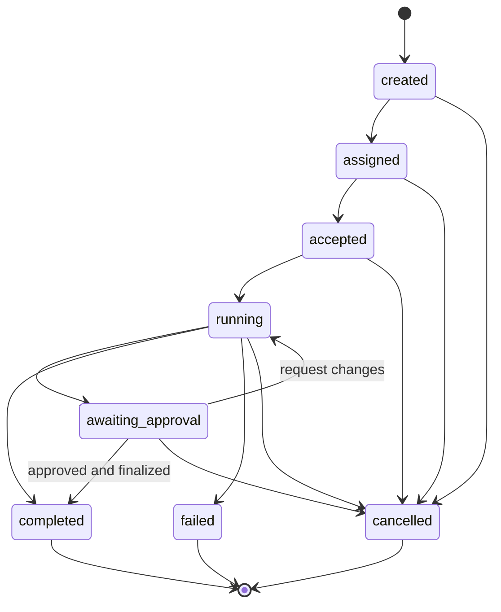

# Wutong Protocol v0.1 — 核心协议与 Agent 原生规范草案

> **Project Wutong（梧桐计划）** · **Wutong Suit**  
> **文档标识**：WTP-CORE-001  
> **规范版本**：`v0.1.0-draft.1`（**设计草案，非已发布互操作标准**）  
> **日期**：2026-10-18  
> **许可政策**：项目自有代码统一 GNU AGPL-3.0-only；本文引用的第三方规范仍归原权利方所有。规范文本及示例的后续公开许可由项目治理正式确定；本草案不构成第三方规范的许可变更。  
> **工程基线**：C++23；Rust Edition 2024；Qt 6.12.0 LTS；Rust CLI / Server / 网络后台；六语言 SDK。

## 0. 摘要与状态边界

Wutong Protocol（WTP）是一套面向本地优先的原生文件、知识对象、可追溯关系、人类与 Agent 协作，以及可选同步、联邦与知识服务的**独立协议**。WTP 不依赖 AT Protocol、ActivityPub、Matrix、MCP、A2A、某一 CRDT 或任何 Wutong 官方服务器；与这些系统的互操作由专门适配层承担。

**本草案要冻结的最小核心**：`Principal`、`Space`、`Object`、`Revision`、`Relation`、`Proposal`、`Task`、`Capability`、`Event` 九种消息的基础语义，以及标识、格式、版本和权限不变量。`DocumentBinding` 是 Object 的扩展而非必须为所有文件创建的外部数据库记录。

**本草案明确尚未冻结**：生产级签名规范的密钥发现与撤销、私有空间端到端加密协议、CRDT 二进制格式、网络发现与联邦路由、完备 Task 工作流、面向服务的远程 Action API。下文涉及这些领域的规则仅定义其与 Core 的边界，尚不声称完整实现。

规范性用语 **MUST / MUST NOT / SHOULD / MAY** 按 [RFC 2119](https://www.rfc-editor.org/rfc/rfc2119) 和 [RFC 8174](https://www.rfc-editor.org/rfc/rfc8174) 解释（仅全大写词适用）。

## 1. 项目不可变要求

1. **Standalone-first**：Wutong Writer 可以仅以 C++23 / Qt 启动，直接编辑本地 `.md`、`.typ`、`.tex` 等原生文件，无账户、无 Wutong Network、无 Wutong Server、无 Agent、无网络。
2. **Local-knowledge independence**：Wutong Knowledge、Wutong Publisher 的本地数据读取、索引、编译、导出以及已安装插件提供的本地功能不得依赖 Network 后台。
3. **Optional networking**：Wutong Network 包含 Qt GUI 及用户可选的 Rust 后台 `wutong-networkd`；关闭 GUI 后可继续运行后台，但卸载/停止后台不得阻断本地文档编辑。
4. **Protocol autonomy**：Wutong Protocol 独立拥有标识、对象、关系、任务、服务和协议版本语义。AT Protocol / ActivityPub / Matrix / MCP / A2A 等是适配对象。
5. **Agent-native but AI-optional**：`agent` 是 Principal 的一个合法类型，协议原生支持任务、委托、修改提案、来源及审阅；所有模型执行必须可选。
6. **Lossless native content**：导入内容不得隐式重排 Markdown 标记、Typst/LaTeX 源码、Unicode 编码、换行符或 BOM。磁盘保存由文件协调器负责，不得使用通用 AST 全文重序列化替代普通编辑路径。
7. **Ownership and security**：读取、修改、审批、公开发布、委派、部署是不同的能力；取得读取权限不推导出写入或发布权限。
8. **Portability**：知识索引可重建；稳定对象标识与文件路径分离；任何可交换的网络对象 MUST 能在不访问 Wutong 官方服务的条件下被解析或验证其结构。

## 2. 规范分层与兼容 Profile

| Profile | 规范目标 | v0.1 状态 |
|---|---|---|
| `WTP-Core` | 标识、交换消息、基本对象与版本语义 | **本草案核心** |
| `WTP-Document` | 原生文件绑定、字节保真、节点引用 | 最小字段已定义；其余待扩展 |
| `WTP-Agent` | Agent Principal、Task、Proposal、Artifact、来源 | **最小交互已定义**；远程编排未定 |
| `WTP-Security` | 签名、Principal 控制证明、委托、密钥轮换 | 约束与候选算法；生产互操作待定 |
| `WTP-Sync` | CRDT、增量复制、快照、成员权限 | 实验 Profile；不在本草案冻结字节格式 |
| `WTP-Federation` | Resolve、Fetch、Subscribe、跨节点寻址 | 实验 Profile |
| `WTP-Service` | 知识查询、Action、Service Spec、部署 | 概念契约，另立规范 |
| `WTP-Interop` | ActivityPub、ATProto、Matrix、CMS、Agent 网关映射 | 适配器契约，另立规范 |

### 2.1 最小一致性等级（建议）

- **WTP-L0 — Local**：能够本地创建、读取和保留 v0.1 Core 对象，执行本地数据验证；不要求任何加密密钥或网络程序。
- **WTP-L1 — Portable**：支持导入/导出核心消息和完整性校验；跨机器可迁移稳定 ID 与版本。
- **WTP-L2 — Secure Exchange**：验证 Principal 身份、规范化签名、消息重放和受限授权（仅在 Security Profile 完整冻结后可声明）。
- **WTP-L3 — Collaborative**：实现某一明确命名的 Sync Profile，包括断网重连、协作状态收敛和可验证快照。
- **WTP-L4 — Federated / Service**：提供开放发现、发布、订阅或服务操作，并声明具体支持的子集。

目前随本文交付的 C++ PoC 只验证 **L0 的一部分本地核心行为**；不能声明 L1–L4 一致性。

## 3. 身份与寻址模型

### 3.1 不同标识的语义

| 类型 | v0.1 候选 | 特性与不变量 |
|---|---|---|
| `Principal ID` | `urn:uuid:<UUIDv7>` | 本地稳定身份；**不代表**公钥所有权证明 |
| `Space ID` | `urn:uuid:<UUIDv7>` | 与文件夹/服务器域名无关 |
| `Object ID` | `urn:uuid:<UUIDv7>` | 对可变知识对象保持稳定 |
| `Revision ID` | `urn:uuid:<UUIDv7>` | 唯一版本事件 ID，不等同于内容哈希 |
| `Content Digest` | `sha256:<64 lowercase hex>` | SHA-256 对**精确原始字节**的散列；`sha256:` 是本规范字段值格式，**不是已注册 URI Scheme** |
| `External Ref` | `https:`, `at:`, `did:` 等目标原生标识 | 不假定与内部 ID 等价；应建立独立绑定 |
| `Locator` | 网络可访问的解析位置及验证元数据 | 与对象稳定身份分离，尚待 Federation Profile |

UUIDv7 按 [RFC 9562 §5.7](https://www.rfc-editor.org/rfc/rfc9562.html#section-5.7) 生成：48-bit Unix 毫秒时间戳、版本/变体位、足够随机熵；时钟信息仅用于大致排序，**不能作为因果或信任依据**。

网络上不得仅凭 `Principal ID` 字符串授予访问。网络身份需在 Security Profile 中通过可验证密钥控制证明、签名授权和撤销状态绑定。

### 3.2 文件绑定 `DocumentBinding`

- `binding.kind=file` 指关联某一工作区中的原生文件；本地数据库保存对象 ID 与实际路径映射。
- 可移植交换中应使用**相对路径**，不得直接公布用户的绝对路径、用户名或设备目录。
- 路径导入必须拒绝 `..` 越界、绝对路径注入、符号链接逃逸以及不受控的虚拟文件路径。
- 原始文件字节为内容层真相；索引、AST、全文搜索结果均为派生数据。协作模式另有活动会话及镜像协调规则。
- 复制相同字节的两个文档**不自动成为同一对象**；同一 Object 的两个 Revision **不自动有相同内容哈希**。
- 允许用户编辑完全未建立 Object ID 的普通文件；启用知识/版本功能时再创建绑定。

## 4. 交换表示：v0.1 JSON Profile

### 4.1 交换信封（Envelope）

```json
{
  "protocol": "wutong/0.1",
  "kind": "wutong.object",
  "id": "urn:uuid:019a1111-1111-7111-8111-000000000064",
  "occurred_at": "2026-10-18T12:00:00Z",
  "payload": {
    "object_id": "urn:uuid:019a1111-1111-7111-8111-000000000004",
    "space_id": "urn:uuid:019a1111-1111-7111-8111-000000000002",
    "owner_id": "urn:uuid:019a1111-1111-7111-8111-000000000003",
    "object_type": "document",
    "media_type": "text/markdown",
    "byte_length": 123,
    "content_digest": "sha256:aaaaaaaaaaaaaaaaaaaaaaaaaaaaaaaaaaaaaaaaaaaaaaaaaaaaaaaaaaaaaaaa",
    "binding": {"kind": "file", "relative_path": "notes/wutong.md"}
  }
}
```

示例数字和散列用于展示结构，**不是**真实文件内容的散列测试向量。可运行 JSON Schema 与机器可读示例在随附 PoC 的 `schemas/`、`examples/` 目录。

**Core Envelope 的最低字段**：`protocol`, `kind`, `id`, `occurred_at`, `payload`。如用于已启用网络安全交换，则还需要根据对应 Security Profile 提供可验证 `proof`。

- `protocol` MUST 为 `wutong/0.1`，使用主/次版本协商，后续重大破坏性更改须提高主版本。
- `kind` MUST 指明核心记录种类；未知类型的透明中继可在只验证基本信封后保留其原始字节，不应擅自解析、重写、授权或执行。
- `id` MUST 在消息重传时保持不变，可用于去重；不意味同一 Object 只允许一个消息。
- `occurred_at` 为 RFC 3339 UTC/带时区时间标记，用于人类展示和诊断，不能代替排序/因果关系。
- `payload` 按对应 `kind` 的 Schema 校验，结构中含显式 `object_id`/`task_id` 等语义标识。
- `extensions` MAY 包含具名扩展，**但未知扩展不得改变授权判定**。生产互操作需规范扩展命名空间归属。
- 对于 JSON Profile，使用 UTF-8、严格 JSON；拒绝重复字段、过度嵌套、超尺寸或超资源限制的输入。

### 4.2 核心消息表

| `kind` | 必要语义 | 不应推断的能力 |
|---|---|---|
| `wutong.principal` | 本地主体类型及稳定 ID | 主体已取得远程身份认证 |
| `wutong.space` | Space 的身份、所有者、可见性 | 所有公开元数据均可读取私有内容 |
| `wutong.object` | 有类型的可变知识对象及当前内容引用 | 必须内嵌全部正文、必须由 Wutong 编辑 |
| `wutong.revision` | 与对象关联的版本、父版本及内容哈希 | 同内容哈希代表同对象 |
| `wutong.relation` | 有作者的关系：源、目标、谓词 | 目标所有者已认可该关系 |
| `wutong.proposal` | 在指定 base 上提出内容或结构修改 | 提案已自动应用 |
| `wutong.task` | 请求者、可选执行者、状态和产物 | 任意 Agent 可自动执行 |
| `wutong.capability` | 最小授权声明（issuer/audience/resource/actions/expiry） | 纯文本声明就是已验证授权 |
| `wutong.event` | 有来源的事件、对象及处理结果 | 事件不可伪造或不可撤销 |

### 4.3 编码、签名与哈希的边界

1. **正文 Blob 哈希**：对原始字节 `SHA-256(bytes)`，不进行 Unicode 归一化、不删除 BOM、不转换 LF/CRLF。
2. **结构化消息规范化**：正式安全消息应采用 [RFC 8785 JSON Canonicalization Scheme](https://www.rfc-editor.org/rfc/rfc8785)，并限定 I-JSON 子集。**不能**把任意 Rust `serde_json`/C++ JSON 输出当成 JCS。
3. **候选签名**：Ed25519，签名域使用明确版本化前缀（候选 `WUTONG-PROTOCOL-v0.1\n`）与**不含 proof 字段**的 JCS 字节；编码、密钥解析、时间/重放窗、失效机制要在 WTP-Security 冻结时形成正式测试向量。
4. **消息与 HTTP 签名区分**：应用层 Event Proof 不等同于传输层 HTTP 签名；外部 HTTP 互操作可另用 [RFC 9421](https://www.rfc-editor.org/rfc/rfc9421.html)。
5. **离线纯本地记录**：允许不含 `proof`，但只能在同一可信本地会话的授权模型中处理；不得因此升级为可信远程声明。

**注意：交付的 C++ PoC 已验证 OpenSSL Ed25519 原始消息签名/篡改拒绝，但尚未实现 JCS + 完整 WTP Security Proof；不可将此烟雾测试视为可互操作的签名实现。**

## 5. Object、Revision、Relation 的语义规则

### 5.1 Object

- `Object ID` 为可变身份，`content_digest` 指向当前某一精确字节表示。
- `object_type` 应能表达 `document`、`media`、`question`、`answer`、`thread`、`service` 等；未知自定义类型不应被假冒成已有类型。
- `owner_id` 是资源所有权**声明**，远端必须验证其与 Space 管理策略、能力链及签名的对应关系。
- `media_type` 和 `byte_length` 仅用于解释/验证内容，不能作为 HTML、代码或音视频执行许可。
- 对于多表示对象，后续 Profile 可定义 `representations[]`（源 Markdown、渲染 HTML、PDF 等），但必须指定哪个是 authoritative Source。

### 5.2 Revision

- 新 Revision 应保留 `object_id`、`author_id`、`content_digest` 和父版本集合 `parents[]`。
- 并发 Revision 可以产生多父版本合并，**但核心并不负责语义正确性**；需编辑器/编译器/审核流程验证。
- `content_digest` MUST 与下载/复制得到的实际正文原始字节匹配，否则拒绝使用该内容。
- Revision 元数据与原始文件的协同写入必须使用恢复协议，不能跨 SQLite 与普通文件系统假设单次事务原子化。

### 5.3 Relation

- 关系作为独立一等记录，必须有稳定 `relation_id`、`source_id`、`target_ref`、`predicate` 和 `author_id`。
- `target_ref` 可指本地 Wutong Object ID 或外部 HTTPS/AT URI 等；解析策略由适配器处理。
- `references`、`derivedFrom`、`contradicts`、`authoredBy` 等谓词只表示**作者的声明**；不自动成为外部目标对象的共同事实。
- 关系撤销应产生有权限、有来源的变更事件，不能无审计痕迹地篡改公开记录。

## 6. Agent 原生 Profile：Task、Capability、Proposal

### 6.1 Agent 身份

- `Principal` 中 `principal_type=agent` 为协议一级类型，允许 Agent 独立持有自己的 Space/Object/Relation/Task。
- Agent Manifest 可声明模型/运行时、支持输入输出类型、工具、资源预算和端点，但 Manifest **不是认证证明或授权许可证**。
- `Agent-as-Principal` 与 `Agent-as-Executor` 必须区分：代理用户执行时需记录代表关系；不得因使用同一个模型而默认为同一身份。

### 6.2 Task 状态机（提案）



该状态机为 v0.1 **候选业务语义**：实际多节点任务需要另定义超时、执行租约、重试、幂等、转交、取消与外部副作用处理；不能只靠某个事件声称 `completed` 即视为操作已生效。

### 6.3 Proposal 必须具备前置条件

- Agent 修改已存在的原生文件时 SHOULD 默认创建 `Proposal`，不得因具备 `document.read` 许可而直接改写。
- 提案至少含 `object_id`、`proposer_id`、`base_digest`、`proposed_digest`、`intent` 与 `status`。
- `apply` 必须验证原始磁盘内容哈希、当前活动会话版本、授权与审核状态；基础版本不匹配时拒绝无条件覆盖，并提供三方合并或冲突备份入口。
- `Reviewer` 可以是按策略授权的人类、组织流程或机器审核主体，而不是硬编码的自然人；v0.1 PoC **仅**使用 owner-only 人工审批演示。
- `Agent 输出` 是数据；只有受信任的 Wutong Core Action Executor 能产生经过权限校验的写入副作用。

### 6.4 Capability 安全语义

有效执行权限应按资源策略、颁发者控制证明、已验证的委托链、资源范围、操作、有效期、撤销状态、运行环境限制及必要审核共同决定；不能仅靠 `wutong.capability` JSON 文本校验决定权限。

**候选受限委托规则**：不得扩权、不得越过父授权有效期、默认不可再委托、可枚举允许动作、显式过期和撤销。离线时如不能确定敏感写入或公开操作的最新撤销状态，应采用受限离线策略/等待联网验证，而不是直接放权。

参考 UCAN 的可验证委托模型（不是照搬其签名表示）：[UCAN Spec](https://github.com/ucan-wg/spec)、[Delegation](https://github.com/ucan-wg/delegation)。本 v0.1 Schema 中的 Capability 仍只是**结构化声明**，签名授权 Profile 另行设计。

### 6.5 来源与 Agent 审计

建议最小 Provenance：`actor`、`delegator`、`task_id`、`input_object_revisions`、`tool/service identity`、`operation`、`output_artifacts`、`review record`。完整链路可以映射 [W3C PROV-O](https://www.w3.org/TR/prov-o/) 的 Entity/Activity/Agent。

- 记录**操作与产物**，不默认公开 LLM 私人上下文、内部推理内容、密钥或不可公开的原始工具结果。
- 模型输出必须按不可信输入处理，所有外部知识或网页文本必须抵御 Prompt Injection。
- 任何公开发布/权限修改/执行外部命令都需单独、可验证的 Capability；执行侧再次检查范围。

## 7. 本地 Wutong Core 的必要 API 契约

### 7.1 建议的语言独立抽象

```text
Principal.createLocal(kind, label) -> PrincipalID
Document.openNative(path) -> FileSession  // 不要求 Object ID
Knowledge.bindDocument(file, owner, space?) -> ObjectID
Document.readBytes(objectID) -> (bytes, digest, revision)
Document.refreshFromDisk(objectID, precondition?) -> Revision
Knowledge.addRelation(source, target, predicate, actor) -> RelationID
Authorization.grantLocal(owner, subject, resource, action) -> GrantID
Agent.propose(object, expectedRevision, change) -> ProposalID
Review.apply(proposal, approver, expectedRevision) -> RevisionID | Conflict
Knowledge.exportPortable(spaceID) -> PortableArchive
```

**重要**：Wutong Core MUST 可作为进程内库运行；这些本地操作不得调用 Network Daemon，也不要求在线 Token。

### 7.2 文件保存协议（生产建议）

针对 `SQLite + native file` 的双存储，应增加持久化写入意图表，建议状态机：

```text
prepare intent (durable) → write temp file → fsync(temp)
→ re-check expected file version/coordination lock
→ atomic replace/rename → fsync(parent directory where supported)
→ update SQLite index/revisions and mark intent committed
→ recovery scan on next startup (roll-forward or reconcile)
```

在 Windows、macOS、Linux 上应分别验证 rename/replace、文件锁、目录持久化、权限、Symlink、大小写与外部编辑进程的竞态。文件系统与数据库不存在自动的跨资源原子事务；在崩溃时**允许进入可恢复的中间态**，但不能出现没有被检测到的无声覆盖。

### 7.3 本地索引与大规模文件

SQLite + FTS5 用于本地查询及关系索引；SQLite WAL 适合本机读写并发，但其官方说明不支持跨机器通过网络文件系统共享同一 WAL 数据库。[SQLite WAL](https://www.sqlite.org/wal.html)

多设备同步应通过 WTP Sync 的变更协议，而不是直接通过共享网络磁盘复制正在写入的 SQLite WAL 文件。

## 8. WTP Sync 与 WTP Federation 的边界

### Sync（待定）

- CRDT 仅用于显式启用协作的 DocumentSession 或结构化协作对象；单机 Standalone File 不必初始化 CRDT。
- 初期评估 Automerge 与 Yrs，不允许同一个对象在运行时同时由两套互不兼容的 CRDT 作为权威状态。
- 定义 `Session ID`, `Replica ID`, `Snapshot`, `Change`, `Heads`, `Cursor`, `Presence` 等，但不要先承诺 CRDT 二进制兼容。
- Presence/光标不进入永久知识历史，加入过期时间和节流。
- 断线时可继续本地编辑，重连后合并；不承诺在完全离线时实时获取远端新内容。

### Federation（待定）

- 对外操作预计为 `Resolve`, `Describe`, `Fetch`, `Subscribe`, `Publish`, `Relate`, `Propose`, `Replicate`, `Invoke`，具体 REST/流接口另行 RFC。
- 永远区分**对外公开表示**与私有协作副本；公开发布必须显式执行，不暴露私有 CRDT 日志。
- 通过 `ExternalBinding` 保存 Wutong Object 与外部平台资源的对应关系、远程版本、权限、保真度与回流策略。
- AT Protocol、ActivityPub、Matrix、MCP、A2A 适配器做协议映射；不得将内部 WTP 事件原样假定成第三方消息。

## 9. 安全威胁模型（最低清单）

| 威胁 | 生产必须满足的控制 | 该 PoC 是否覆盖 |
|---|---|---|
| 假冒 Agent / Principal | 签名、密钥绑定、授权链 | **否**（仅本地身份字符串） |
| JSON 重放/签名歧义 | JCS 严格实现、重放窗、幂等 | **否**（仅结构 Schema） |
| 越权修改文档 | 双重版本前置条件 + Capability | 部分：本地受控审批 |
| 外部文件修改竞争 | 文件协调器、Crash Recovery | 部分：内容哈希拒绝 |
| 任意路径与 Symlink 攻击 | Path containment、目录能力、原子操作 | **否** |
| 恶意大文件与资源耗尽 | Schema/Blob 限额、流式解析、超时 | **否** |
| CRDT 恶意变更 | 变更认证、大小限制、解码隔离 | **否** |
| 联邦 SSRF / Webhook 伪造 | HTTPS 策略、域名与网络目标验证 | **否** |
| 不可信 Agent Prompt Injection | 工具与数据隔离、Policy Executor | 概念分层，未实测 |
| 私有数据意外公开 | Publication Materialization、独立密钥域 | **否** |

## 10. 实现边界与工程技术决策

- **客户端与编辑器**：C++23 + Qt 6.12.0 LTS，QML 负责 GUI；`wutong-core-cpp` 进程内提供 Native File/Knowledge 功能。
- **后台与网络**：Rust Edition 2024，实现 `wutong-networkd`（按需启用）、`wutong-server`、`wutong-cli`，网络与服务共享可复用 Rust crates。
- **SDK**：C++、C#、Python、Rust、Go、TypeScript 使用同一套 Schema、协议行为与兼容性测试；本地嵌入式 Core 可以由 C++ 直接链接，远程采用通用 API/事件协议。六语言 SDK 的 AGPL 授权策略按项目既定政策执行。
- **跨语言**：UI 与后台优先通过版本化 IPC/RPC 或网络协议通信；只有高性能或需要嵌入式能力的地方采用安全、有限的 C ABI；Rust C ABI 接口不跨越 Rust panic，也不暴露 C++/Qt 对象生命周期。
- **数据层**：原生文件 + 本地 SQLite + 可选 Blob/CAS；工作区可移植元数据与大型派生索引分离。
- **许可证**：项目新建代码使用 `SPDX-License-Identifier: AGPL-3.0-only`；第三方代码不得因此被重标许可；依赖需进行 SBOM、GPL/LGPL/AGPL 兼容性审查。

## 11. 机器可执行合同与下一版冻结门槛

本草案随附的 `wutong-v0.1-core-poc` 提供：

- `schemas/wutong-core.schema.json`：JSON Schema Draft 2020-12，覆盖 9 种核心消息。
- `examples/*.json`：9 个合法交换消息示例。
- `tests/test_schema.py`：有效示例、非法版本、非法 ID、未知顶层字段及缺失字段等合同测试。
- `include/wutong/core.hpp`、`src/core.cpp`：C++23 离线数据层原型。
- `tests/test_core.cpp`：源文件保真、UUIDv7、SHA-256、Agent 提案、审批、外部修改、持久化与 Ed25519 原语测试。

**v0.1 进入下一阶段（draft.2）的门槛**：

1. 两种不同编程语言产生完全相同的 JCS 与 Ed25519 测试向量。
2. 完成 Principal Key Control / Rotation / Revocation 流程并做攻击测试。
3. 实现文件写入意图日志与跨进程协作协调，完成断电/崩溃注入测试。
4. Rust Edition 2024 完成与 C++ 核心同样的跨语言对象合同测试，并固定 C ABI/IPC 边界。
5. 对明确选定的一种 CRDT 实现完成离线分叉与收敛实测。
6. 实现至少一个独立第三方 Wutong Core 只读解析器，不依赖 Wutong Network / Server。
7. 进行路径遍历、未知类型保持、恶意大对象、并发变更和用户隐私数据泄露测试。

## 12. 主要参考资源

### 标准与协议

1. RFC 9562 — UUID, UUIDv7：https://www.rfc-editor.org/rfc/rfc9562.html
2. RFC 8785 — JSON Canonicalization Scheme：https://www.rfc-editor.org/rfc/rfc8785.html
3. JSON Schema Draft 2020-12：https://json-schema.org/draft/2020-12
4. RFC 9421 — HTTP Message Signatures：https://www.rfc-editor.org/rfc/rfc9421.html
5. W3C DID Core：https://www.w3.org/TR/did-core/
6. W3C PROV-O：https://www.w3.org/TR/prov-o/
7. W3C Web Annotation Data Model：https://www.w3.org/TR/annotation-model/
8. UCAN Specification：https://github.com/ucan-wg/spec
9. UCAN Delegation：https://github.com/ucan-wg/delegation
10. AT Protocol Lexicon：https://atproto.com/specs/lexicon
11. ActivityPub：https://www.w3.org/TR/activitypub/
12. Matrix Client-Server API：https://spec.matrix.org/latest/client-server-api/
13. A2A Protocol：https://a2a-protocol.org/latest/specification/
14. MCP Specification：https://modelcontextprotocol.io/specification/2026-07-28

### 工程与实现

15. SQLite WAL：https://www.sqlite.org/wal.html
16. SQLite Atomic Commit：https://www.sqlite.org/atomiccommit.html
17. Automerge：https://github.com/automerge/automerge
18. Automerge Sync API：https://docs.rs/automerge/latest/automerge/sync/index.html
19. Yrs / yffi：https://docs.rs/yffi/latest/yffi/
20. Qt 6.12 LTS：https://www.qt.io/blog/qt-6.12-released
21. Rust Edition 2024：https://doc.rust-lang.org/edition-guide/rust-2024/index.html
22. GNU AGPL v3：https://www.gnu.org/licenses/agpl-3.0.html
23. Local-first Software（Ink & Switch）：https://www.inkandswitch.com/essay/local-first/
24. OpenSSL EVP Digital Signatures：https://docs.openssl.org/3.0/man3/EVP_DigestSignInit/

---

**本草案结论**：优先冻结对象、版本、受限 Agent 提案与跨语言 Schema；在完成安全签名、文件事务恢复及协作互操作验证之前，不将实验性的网络交换能力标为生产级 Wutong Protocol v0.1。
